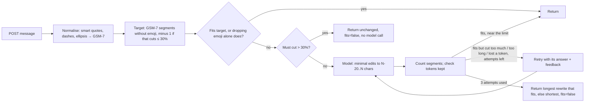

# jethro.au SMS shortener

A Cloudflare Worker that rewords an SMS message so it fits in fewer SMS
segments while keeping its meaning, using [Workers AI](https://developers.cloudflare.com/workers-ai/).
A 170-character message costs two segments per recipient; reworded to 160
GSM-7 characters it costs one, which halves the cost of a bulk send.

[Jethro](https://github.com/tbar0970/jethro-pmm)'s SMS composer uses it: after
3 seconds without typing, a multi-segment message to more than one recipient
gets a "shorter alternative" suggestion with a *Use this instead* link.

Also included is a PHP client, installed with Composer as `jethro/jethro-sms-shortener`.

## How it works



- **The Worker counts, the model only writes.** LLMs can't count characters
  reliably, so the Worker measures every rewrite with GSM 03.38 / UCS-2
  segment maths and retries with a tighter budget (and the measured length as
  feedback) until it fits, up to 3 model calls.
- **Normalising first.** A single `’`, `–` or `…` forces the whole message
  into UCS-2 (70 characters per segment instead of 160). Replacing them with
  GSM-7 equivalents often saves a segment without any model call.
- **Protected tokens.** Jethro placeholders (`%firstname%`,
  `%selected.firstname%`, `%(shorten "…")%`), URLs and phone numbers must
  appear verbatim in a rewrite, or it is rejected.
- **Minimal edits.** The model is told to keep the original wording, order
  and every detail, cutting filler first, then abbreviating, then rephrasing,
  and to land within 20 characters under the budget. A rewrite that fits but
  cuts more than that (models like to summarise, dropping details) is retried
  with "keep more of the wording", within the 3 calls; of the rewrites that
  fit, the longest wins.
- **Target.** Rewrites are GSM-7, so the target is worked out from the text
  without emoji and other non-GSM characters: one segment fewer than that
  uses, when getting there means cutting at most 30%, else just what dropping
  them gives. A message whose only problem is an emoji (a UCS-2 segment holds
  70 characters, a GSM-7 one 160) comes back with the emoji dropped and no
  model call. A caller's `segments` is a maximum; a better target is used when
  available.
- **Only promising cases reach the model.** When fitting the target would
  mean cutting more than 30% of the text (e.g. 300 characters into 160), the
  Worker returns `fits: false, attempts: 0` without a model call: that much
  cutting loses meaning. Just over a boundary (161 characters: cut 1) is
  always tried.

Callers should still re-count the result with their own segment maths, since
that is what their SMS gateway bills.

## Model and cost

The default model is `@cf/meta/llama-3.3-70b-instruct-fp8-fast`, which follows
length limits far better than the small models. Override it with a `MODEL`
variable. One attempt is roughly 250 input and 60 output tokens, about 19
Neurons with the 70B model. Workers AI includes 10,000 Neurons a day on every
plan (about 500 attempts); beyond that Workers Paid charges $0.011 per 1,000
Neurons ([pricing](https://developers.cloudflare.com/workers-ai/platform/pricing/)).

The `RATE_LIMITER` binding caps each API key at 20 requests a minute.

## API keys

The Worker shares the [jethro.au URL shortener](https://github.com/jethro-chms/jethro-url-shortener)'s
keys: its `API_KEYS` binding is that Worker's KV namespace, which this Worker
only reads (`tok:{sha256(token)}` → `apikey:{id}`, accepting `admin` and
`create` keys). Keys are created and revoked with the URL shortener's tooling,
including its self-service `/signup`. The bootstrap `API_KEY` secret is also
accepted.

## Privacy

SMS text is personal information that leaves the church's own systems, so the
Worker serves a privacy page at `GET /sms-shortener/privacy` (`privacy.js`).
It says what is sent and when, who sees the text (this Worker, which stores
and logs none of it; Cloudflare Workers AI, with links to Cloudflare's
data-usage terms and privacy policy; the model's maker, who does not receive
it), and what registration stores. It names the operator and contact from
`PRIVACY_OPERATOR` / `PRIVACY_CONTACT`, and the model from `MODEL`. Models
other than the default are described generically: add them to `MODELS` in
`privacy.js` after checking Cloudflare's model catalogue.

Jethro links to the page from its SMS Shortening registration form
(`smsShortenerConfig()['privacy']` in the PHP client), and the jethro.au
signup page and sign-in email link to it for SMS shortener signups.

## API

### Shorten a message

```bash
curl -X POST https://jethro.au/api/sms-shorten \
  -H "Authorization: Bearer cus_..." \
  -H "Content-Type: application/json" \
  -d '{"message": "Hi %firstname%, a reminder that the working bee ...", "segments": 1}'
```

`segments` is optional (default: one fewer than the message uses). Messages
are limited to 1530 characters.

```json
{
  "message": "Hi %firstname%, working bee Sat 8am-noon at the hall. Bring gloves, hat & water. https://example.com/working-bee",
  "fits": true,
  "attempts": 1,
  "target": 1,
  "original": { "encoding": "GSM-7", "length": 211, "segments": 2 },
  "result": { "encoding": "GSM-7", "length": 112, "segments": 1 }
}
```

`length` is in GSM-7 septets (extension characters such as `€` count 2) or,
for UCS-2, UTF-16 code units. When no attempt fits, `fits` is false and
`message` is the shortest acceptable rewrite.

| Status | Meaning |
|---|---|
| 400 | Body is not JSON, `message` is empty or too long, or `segments` is not a positive integer |
| 401 | Missing or unknown API key |
| 429 | Rate limit exceeded |
| 502 | Workers AI call failed |

## PHP library

```php
require 'vendor/autoload.php';   // or require 'src/php/SmsShortener.php';

define('SMSSHORTENER', 'jethroau');            // optional; the default
define('SMSSHORTENER_API_KEY', 'cus_...');

$r = getSmsShortener()->shorten($message);      // or ->shorten($message, segments: 1)
if ($r['fits']) echo $r['message'];
```

`SMSSHORTENER` is `jethroau` (= `https://jethro.au`, the default when
undefined) or the base URL of a self-hosted Worker. `smsShortenerConfig()`
interprets it. `shorten()` throws `RuntimeException` on network and API
errors; its timeout is 20 seconds.

## Quick start

### 1. Clone and install

```bash
git clone https://github.com/jethro-chms/jethro-sms-shortener.git
cd jethro-sms-shortener
pnpm install
```

### 2. Configure `cloudflare.config.ts`

```bash
cp cloudflare.config.example.ts cloudflare.config.ts
```

Set the route patterns and zone, `API_KEYS` to the URL shortener's KV
namespace id, and `PRIVACY_OPERATOR` / `PRIVACY_CONTACT` to who runs the
service and how to reach them about privacy. `cloudflare.config.ts` is
gitignored.

### 3. Deploy with the bootstrap key

A Worker that doesn't exist yet can't have secrets set in advance, so the
first deploy supplies `API_KEY` from a file (delete it afterwards):

```bash
(umask 077; echo "API_KEY=$(openssl rand -hex 24)" > .secrets.deploy)
npx cf deploy --secrets-file .secrets.deploy
rm .secrets.deploy
```

Later deploys are plain `npx cf deploy`. To change the key:

```bash
npx cf workers secrets update API_KEY --worker sms-shortener --type secret_text --text "<new key>"
```

## Tests

```bash
node test_worker.js          # offline: fake Workers AI and KV, no account needed
BASE_URL=https://jethro.au API_KEY=cus_... node test_worker.js   # live (costs Neurons)
SMSSHORTENER_API_KEY=cus_... php src/php/test.php                 # PHP client, live
```

For `npx cf dev`, `.dev.vars` holds local values for the secrets declared in
`cloudflare.config.ts` (e.g. `API_KEY=test`). Workers AI always runs remotely,
so `cf dev` needs a logged-in account.

### Devbox

```bash
devbox run test                    # offline worker tests
devbox run test-live               # PHP client against the deployed worker
devbox run shorten "<message>" [segments]
devbox run deploy
```

`devbox.json` loads `.env` (see `.env.example`).

## License

Apache-2.0
